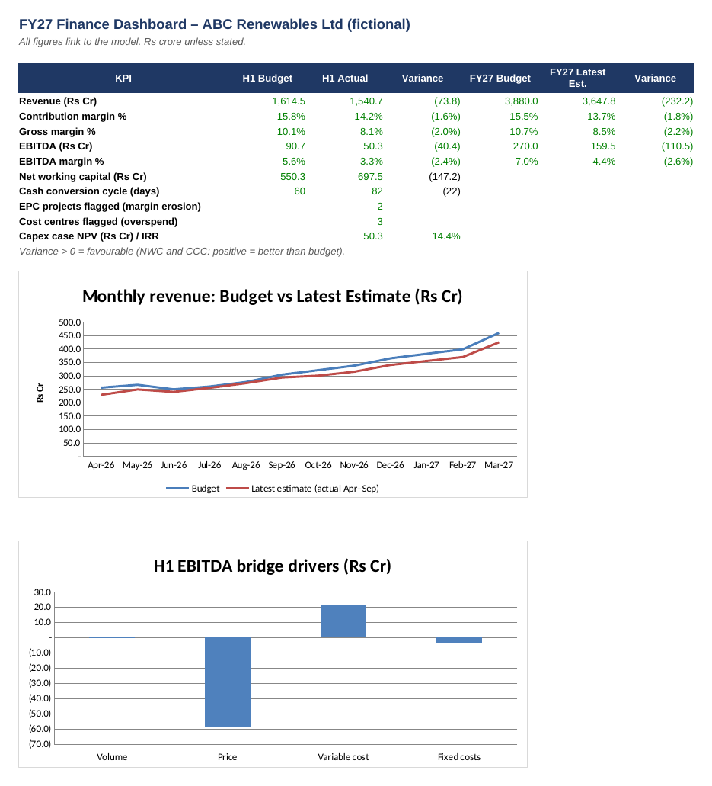
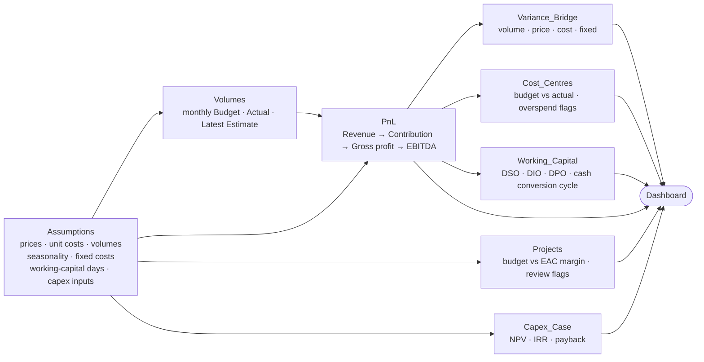
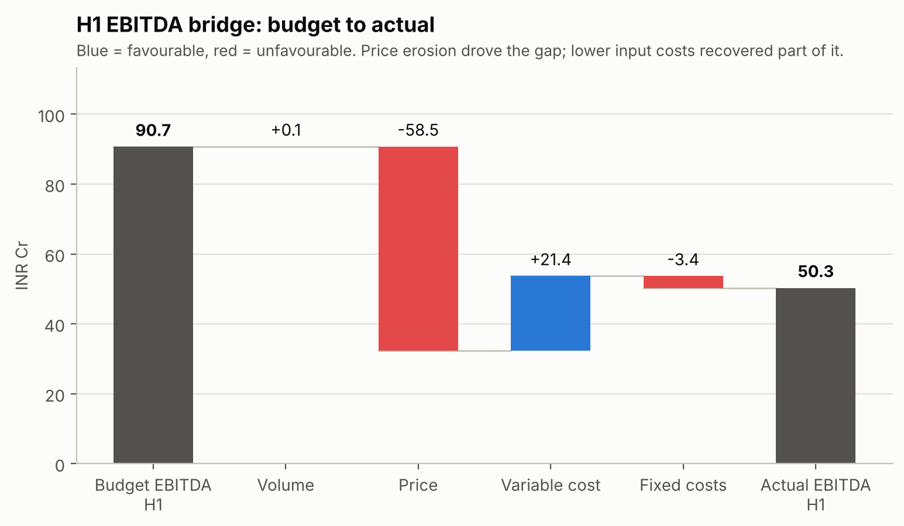
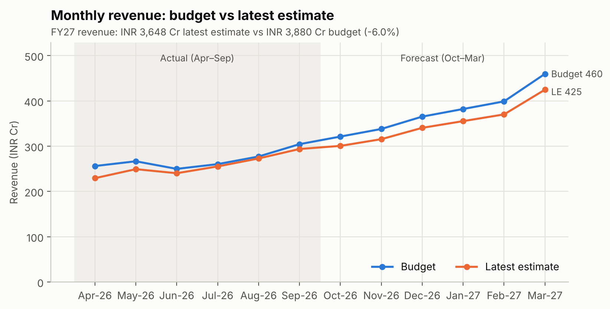
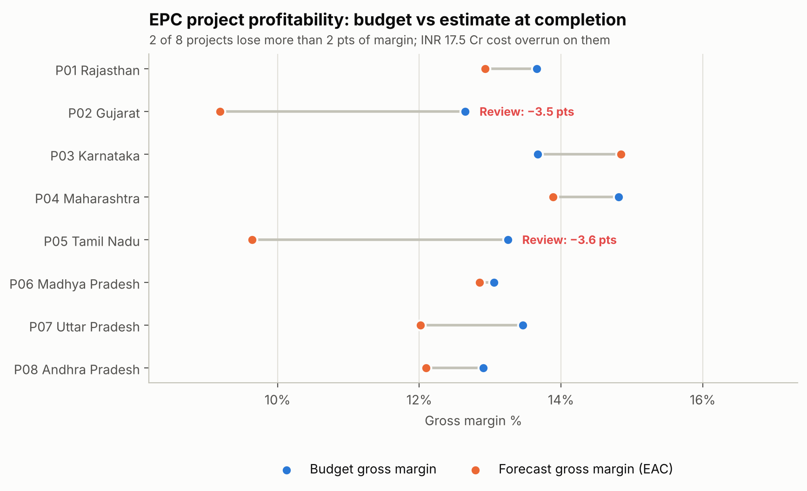
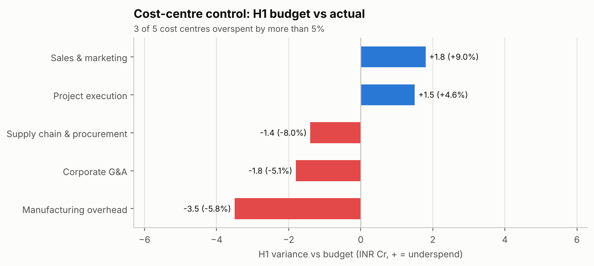
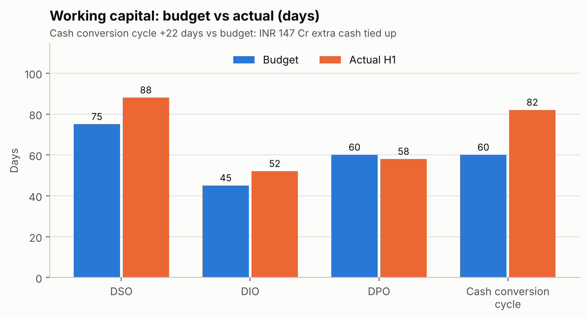
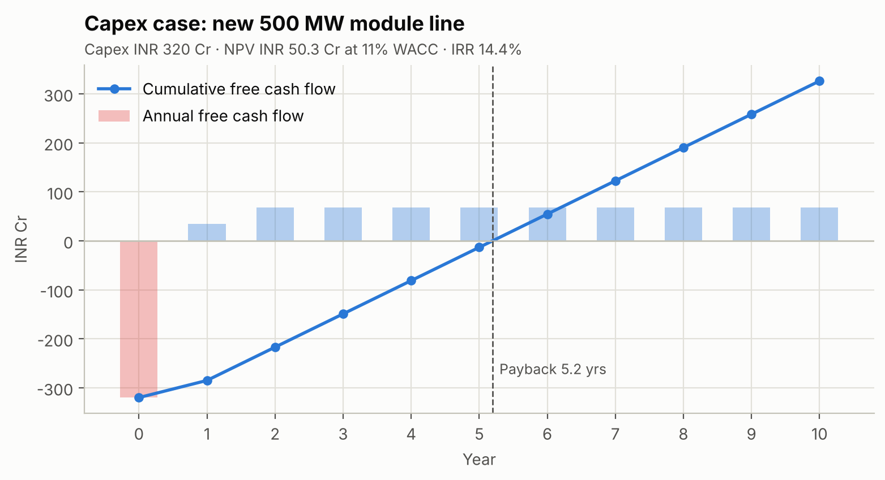
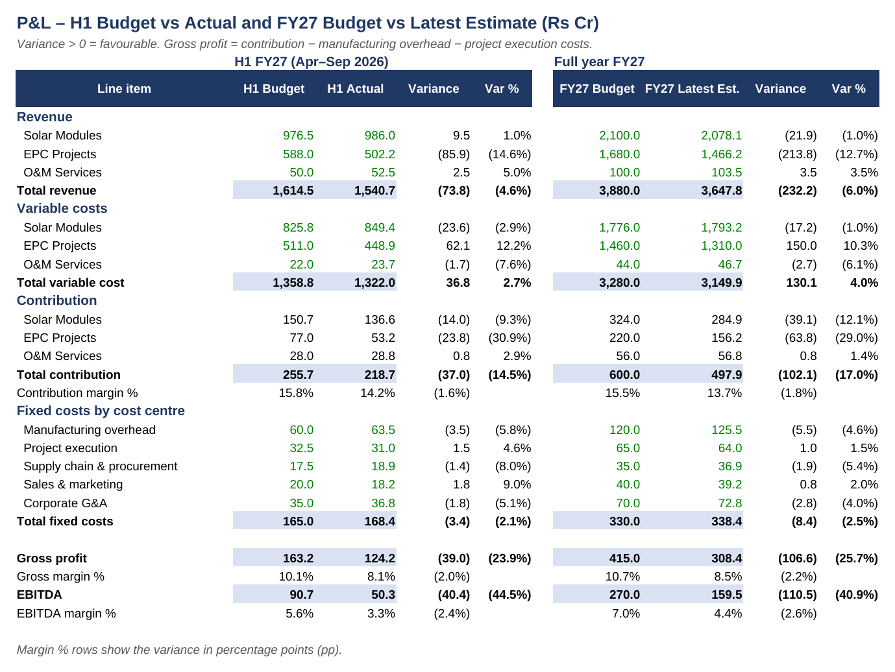
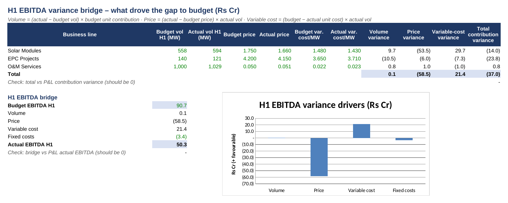

# FY27 FP&A Variance Analysis – Renewable Energy

An Excel FP&A model for **ABC Renewables Ltd**, a *fictional* solar module manufacturer and EPC company. It works through the monthly MIS cycle a business-finance team runs:
- budget vs actual vs forecast
- variance drivers
- project and cost-centre control
- working capital
- a capex business case

The repo also includes a written [management commentary](docs/H1_FY27_Management_Commentary.md) and a Python script that regenerates every chart from the model.

> All data are synthetic, built for practice. Amounts are in ₹ crore. The model has 755 live formulas, so changing any input recalculates everything.



## Business questions it answers

1. **How did H1 (Apr–Sep 2026) perform against budget, and why?** P&L by business line, plus an EBITDA bridge split into volume, price, variable-cost and fixed-cost effects.
2. **Where will the full year land?** A Latest Estimate built from H1 actuals plus an H2 forecast.
3. **Which EPC projects are losing margin?** Budget vs estimate-at-completion (EAC) gross margin, with automatic review flags.
4. **Which cost centres are overspending?** Budget vs actual by owner function (Manufacturing, Projects, Supply Chain, Sales, Finance).
5. **How much cash is stuck in working capital?** DSO, DIO, DPO, net working capital and the cash conversion cycle.
6. **Should we invest in a new 500 MW module line?** 10-year free cash flow, NPV, IRR and payback.

## How the model fits together



Every input lives on one sheet (`Assumptions`, blue text). Everything downstream is a formula, and two reconciliation checks confirm that the variance bridge ties back to the P&L.

## Key findings (base case)

| Metric | H1 Budget | H1 Actual | Variance |
|---|---:|---:|---:|
| Revenue (₹ Cr) | 1,614.5 | 1,540.7 | (73.8) |
| Contribution margin | 15.8% | 14.2% | (1.6 pp) |
| Gross margin | 10.1% | 8.1% | (2.0 pp) |
| EBITDA (₹ Cr) | 90.7 | 50.3 | (40.4) |
| EBITDA margin | 5.6% | 3.3% | (2.4 pp) |
| Cash conversion cycle (days) | 60 | 82 | 22 days worse |

### 1. Price erosion drove the EBITDA gap
Module price erosion cost **₹58.5 Cr** of EBITDA, and lower cell and wafer costs recovered **₹21.4 Cr** of it. Volume netted to about zero: module volume was 36 MW above budget, while EPC was 19 MW behind because of execution delays.



### 2. The full year will miss budget by about 6% on revenue and 41% on EBITDA
The latest estimate (actuals plus forecast) puts FY27 revenue at ₹3,647.8 Cr against a ₹3,880 Cr budget, and EBITDA at ₹159.5 Cr against ₹270 Cr.



### 3. Two EPC projects need review
P02 Gujarat and P05 Tamil Nadu have each lost about 3.5 pts of gross margin against budget, with ₹17.5 Cr of cost overrun between them.



### 4. Three of five cost centres overspent by more than 5%
Manufacturing overhead, supply chain & procurement and corporate G&A are over budget. Sales and project execution are under.



### 5. Working capital ties up an extra ₹147 Cr
DSO is up 13 days against budget. Each 1-day cut releases about ₹8.4 Cr, so getting back to the 75-day target frees about ₹109 Cr.



### 6. The capex case clears the hurdle rate
A ₹320 Cr, 500 MW module line returns NPV ₹50.3 Cr at 11% WACC, IRR 14.4%, with payback in 5.2 years.



## Methodology

**Variance sign convention:** a positive variance is favourable. Revenue and profit variance = actual − budget; cost variance = budget − actual.

**EBITDA bridge**, per business line:

```
Volume variance        = (Actual volume − Budget volume) × Budget unit contribution
Price variance         = (Actual price − Budget price) × Actual volume
Variable-cost variance = (Budget unit cost − Actual unit cost) × Actual volume
Fixed-cost variance    = Budget fixed cost − Actual fixed cost
Budget EBITDA + all variances = Actual EBITDA   (check cell = 0)
```

**Working capital:**

```
Receivables = Revenue × DSO / 365        Inventory = Variable cost × DIO / 365
Payables    = Variable cost × DPO / 365  NWC = Receivables + Inventory − Payables
Cash conversion cycle = DSO + DIO − DPO
```

**Project profitability:** estimate at completion (EAC) = cost incurred + estimate to complete. Margin erosion = budget GM − forecast GM. A project is flagged if erosion is more than 2 pts.

**Capex:** free cash flow = EBITDA − tax − capex. Tax is charged on (EBITDA − straight-line depreciation). NPV is at WACC, and payback is interpolated from cumulative FCF.

## Model preview

| P&L: H1 Budget vs Actual and FY27 Budget vs Latest Estimate |
|---|
|  |

| Variance bridge sheet |
|---|
|  |

## Repository structure

```
├── FY27_FPA_Variance_Model.xlsx          # the model (10 sheets, 755 formulas)
├── docs/
│   └── H1_FY27_Management_Commentary.md  # MIS commentary written from the model
├── analysis/
│   ├── make_charts.py                    # rebuilds every chart in images/ from the model
│   └── requirements.txt
└── images/                               # charts and sheet previews used above
```

## How to use it

1. Open `FY27_FPA_Variance_Model.xlsx` and start on the **Dashboard** sheet.
2. Change any **blue** input on `Assumptions`, such as module price, EPC volume, DSO or WACC. Every sheet recalculates.
3. Check that `Variance_Bridge` K8 and B17 both read **0**. That confirms the bridge still reconciles.
4. To refresh the charts after changing inputs, save the workbook in Excel, then run:
   ```bash
   cd analysis
   pip install -r requirements.txt
   python make_charts.py
   ```

Colour code in the workbook: blue = input, black = formula, green = link to another sheet, yellow fill = key assumption.

## Concepts covered

Budgeting and forecasting · MIS and management reporting · variance analysis (price/volume/cost) · contribution and gross margin · EBITDA · cost-centre control · project profitability (EAC) · working capital (DSO/DIO/DPO, CCC) and cash flow · capex appraisal (NPV, IRR, payback) · Excel dashboards · Python automation of reporting
