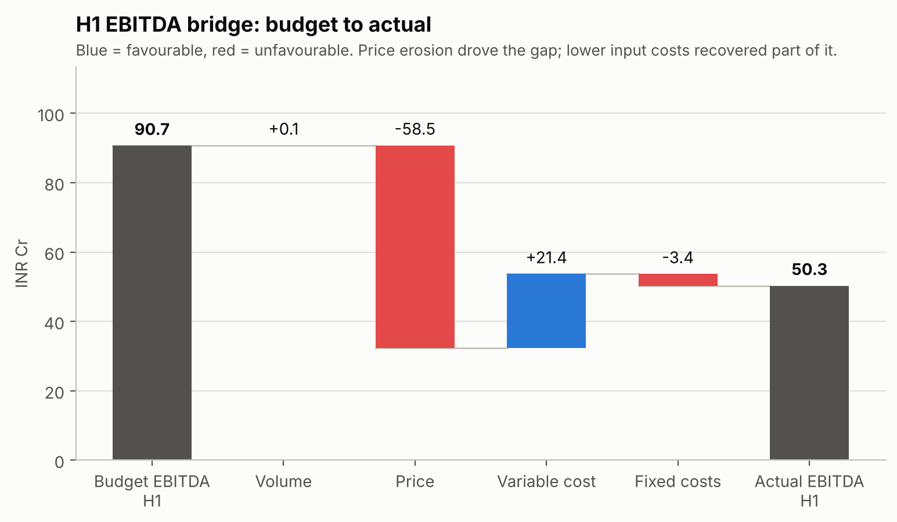
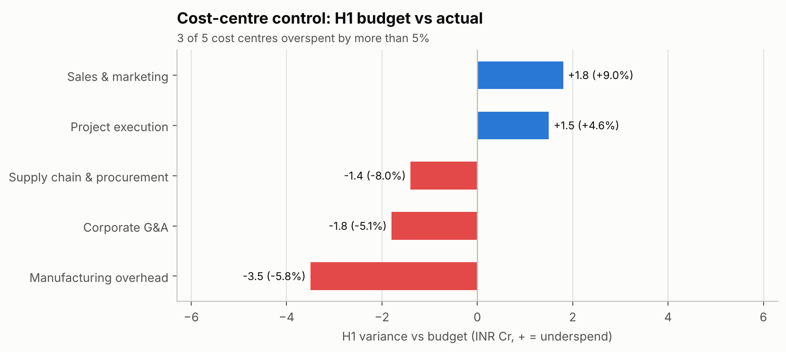
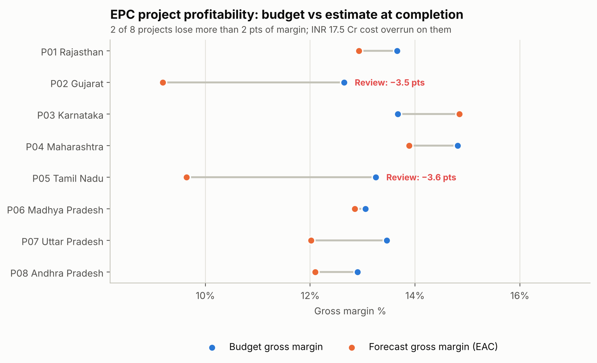
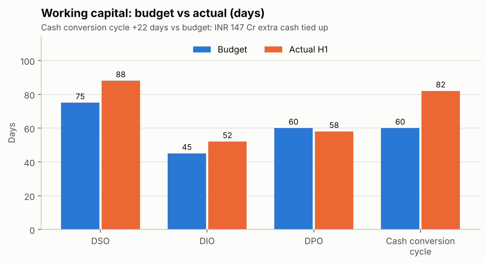
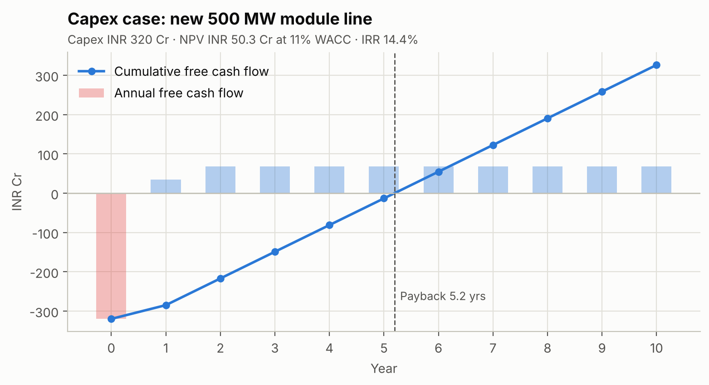

# H1 FY27 Management Commentary – ABC Renewables Ltd

**Period:** April–September 2026 (H1 FY27) · **Prepared by:** Business Finance (FP&A)
**Basis:** [FY27_FPA_Variance_Model.xlsx](../FY27_FPA_Variance_Model.xlsx). *ABC Renewables is a fictional company and all figures are synthetic.* Amounts are in ₹ crore.

## Headline

H1 EBITDA came in at **₹50.3 Cr against a ₹90.7 Cr budget (−₹40.4 Cr, −44.5%)**, and the EBITDA margin fell from 5.6% to 3.3%. The gap is almost entirely **module price erosion** (−₹58.5 Cr), partly offset by **lower input costs** (+₹21.4 Cr). On current trends, the full-year latest estimate is **₹159.5 Cr EBITDA vs ₹270 Cr budget**.

## P&L summary

| ₹ Cr | H1 Budget | H1 Actual | Variance | FY27 Budget | FY27 Latest Est. | Variance |
|---|---:|---:|---:|---:|---:|---:|
| Revenue | 1,614.5 | 1,540.7 | (73.8) | 3,880.0 | 3,647.8 | (232.2) |
| Contribution | 255.7 | 218.7 | (37.0) | 600.0 | 497.9 | (102.1) |
| Contribution margin | 15.8% | 14.2% | (1.6 pp) | 15.5% | 13.7% | (1.8 pp) |
| Gross margin | 10.1% | 8.1% | (2.0 pp) | 10.7% | 8.5% | (2.2 pp) |
| Fixed costs | 165.0 | 168.4 | (3.4) | 330.0 | 338.4 | (8.4) |
| **EBITDA** | **90.7** | **50.3** | **(40.4)** | **270.0** | **159.5** | **(110.5)** |
| EBITDA margin | 5.6% | 3.3% | (2.4 pp) | 7.0% | 4.4% | (2.6 pp) |

## What drove the variance

| ₹ Cr | Volume | Price | Variable cost | Total contribution |
|---|---:|---:|---:|---:|
| Solar Modules | +9.7 | (53.5) | +29.7 | (14.0) |
| EPC Projects | (10.4) | (6.0) | (7.3) | (23.8) |
| O&M Services | +0.8 | +1.0 | (1.0) | +0.8 |
| **Total** | **+0.1** | **(58.5)** | **+21.4** | **(37.0)** |

1. **Solar Modules: price down, volume up.** Volume beat budget by 36 MW (594 vs 558 MW, +6.5%). But the realised price fell 5.1% to ₹1.66 Cr/MW, against a ₹1.75 Cr/MW budget. Cheaper cells and wafers brought unit cost down to ₹1.43 Cr/MW (budget ₹1.48 Cr/MW), which recovered about half of the price impact. Net contribution was −₹14.0 Cr.
2. **EPC Projects: execution delays.** Installed capacity was 19 MW behind budget (121 vs 140 MW, −13.6%), and unit costs rose to ₹3.71 Cr/MW. Contribution was −₹23.8 Cr, the largest single business-line gap.
3. **O&M Services: steady.** The contracted base grew slightly, and contribution was +₹0.8 Cr.
4. **Fixed costs: ₹3.4 Cr over budget (2.1%).** Three of five cost centres overspent by more than 5%: manufacturing overhead (−₹3.5 Cr), corporate G&A (−₹1.8 Cr) and supply chain & procurement (−₹1.4 Cr). Sales & marketing and project execution were under budget.

## Project review

Two of eight EPC projects have lost more than 2 pts of gross margin against budget, with **₹17.5 Cr** of cost overrun between them:

| Project | Budget GM | Forecast GM (EAC) | Erosion | Cost overrun |
|---|---:|---:|---:|---:|
| P02 Gujarat (80 MW) | 12.7% | 9.2% | 3.5 pts | ₹11.5 Cr |
| P05 Tamil Nadu (40 MW) | 13.3% | 9.6% | 3.6 pts | ₹6.0 Cr |

## Working capital and cash

Net working capital is **₹147 Cr above budget** (₹697.5 Cr vs ₹550.3 Cr). The cash conversion cycle has stretched from 60 to 82 days:
- DSO is 88 days against a 75-day budget. This is the main driver.
- DIO is 52 days against a 45-day budget.
- DPO is 58 days against a 60-day budget.

Each 1-day cut in DSO releases about ₹8.4 Cr of cash. Getting back to the 75-day target would release about **₹109 Cr**.

## Full-year outlook

The latest estimate assumes module prices soften further in H2 (₹1.62 Cr/MW, against ₹1.66 Cr/MW in H1). It raises module volume 5% above budget, and cuts EPC volume 10% below budget because execution delays persist. On that basis, FY27 revenue is ₹3,647.8 Cr (−6.0% vs budget) and EBITDA is ₹159.5 Cr (−40.9%).

## Recommended actions

1. **Protect module margin.** Review pricing on new orders, and push for input-cost pass-through clauses linked to cell and wafer prices.
2. **EPC recovery plan.** Run a joint Projects–Procurement cost-to-complete review on P02 and P05, and commit to a recovery schedule for the delayed MW.
3. **Collections drive.** Bring DSO back towards 75 days; that alone releases about ₹109 Cr.
4. **Cost discipline.** Review manufacturing overhead, supply chain and G&A spend with the function heads before the Q3 forecast.
5. **Capex: new 500 MW module line.** The base case gives NPV ₹50.3 Cr at 11% WACC, IRR 14.4% and payback 5.2 years, so **proceed**. First, run a sensitivity check on contribution per MW, given the price erosion seen in H1.

